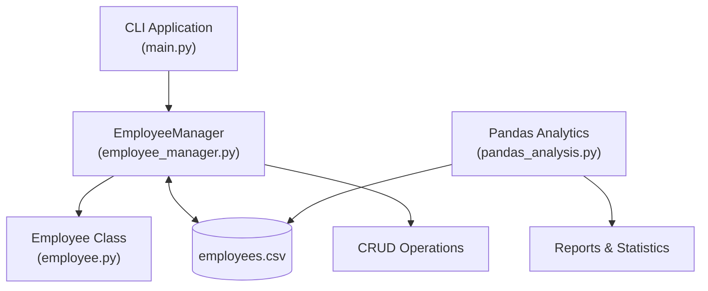

# 🏢 Employee Management System (EMS)

[](https://www.python.org/)
[](https://pandas.pydata.org/)
[](#-data-storage--schema)
[](https://opensource.org/licenses/MIT)

A Python-based **Employee Management System** built using Object-Oriented Programming (OOP), Pandas, and CSV file handling. The application provides employee record management, input validation, persistent data storage, and workforce analytics through an interactive command-line interface.

## 📌 Table of Contents

- [Overview](#-overview)
- [Key Features](#-key-features)
- [System Architecture](#-system-architecture)
- [Project Structure](#-project-structure)
- [Data Storage & Schema](#-data-storage--schema)
- [Installation & Setup](#-installation--setup)
- [Usage Guide](#-usage-guide)
- [Error Handling & Validation](#-error-handling--validation)
- [Future Enhancements](#-future-enhancements)
- [Contributing](#-contributing)
- [License](#-license)
- [Author](#-author)

---

## 📖 Overview

The Employee Management System simplifies the process of managing employee records and analyzing workforce data.

Built with a modular, object-oriented design, the system separates employee information, business logic, data persistence, and analytics into dedicated components.

### 🎯 Project Objectives

- Apply Object-Oriented Programming concepts in a practical Python project.
- Implement CRUD operations for employee records.
- Maintain employee data using CSV file persistence.
- Validate employee details to prevent invalid entries.
- Use Pandas to generate meaningful workforce statistics and reports.

## ✨ Key Features

### 👥 Employee Management

- **Add Employees:** Register employees with automatically generated unique IDs.
- **Search Employees:** Retrieve employee details using their employee ID.
- **Update Records:** Modify salary, performance scores, and attendance.
- **Delete Employees:** Remove employee records from the system.
- **Display Employees:** View all registered employees.

### 📊 Workforce Analytics with Pandas

- Calculate total employee count and average salary.
- Analyze average attendance and performance scores.
- Identify the highest-paid and lowest-paid employees.
- Find top-performing employees.
- Analyze employee distribution by department.
- Generate department-wise salary statistics.
- Identify employees with attendance below a specified threshold.
- Display the top five and bottom five earners.
- Sort employee records by salary.

### 💾 Data Persistence

- Store employee records in a CSV file.
- Load existing records when required.
- Save changes to maintain data between program executions.
- Determine the next employee ID from existing records to reduce ID collisions.

### 🛡️ Input Validation

- Reject zero or negative salaries.
- Restrict performance scores to the range of 0–100.
- Restrict attendance percentages to the range of 0–100.
- Handle invalid menu inputs and missing CSV files.

---

## 🏗️ System Architecture

The project follows a modular architecture that separates the user interface, core business logic, data storage, and analytics.



### Core Components

| Component | Responsibility |
|---|---|
| `employee.py` | Defines the Employee class and employee attributes. |
| `employee_manager.py` | Handles employee management, validation, CSV operations, and analytics-related methods. |
| `main.py` | Provides the interactive command-line menu. |
| `pandas_analysis.py` | Performs data analysis and generates workforce reports. |
| `employees.csv` | Stores employee records persistently. |

---

## 📂 Project Structure

```text
Employee-Management-System/
│
├── employee.py
├── employee_manager.py
├── employees.csv
├── main.py
├── pandas_analysis.py
├── requirements.txt
├── .gitignore
└── README.md
```

---

## 💾 Data Storage & Schema

Employee records are stored in `employees.csv`.

| Column | Description |
|---|---|
| `Employee ID` | Unique employee identifier |
| `Name` | Employee's full name |
| `Department` | Department to which the employee belongs |
| `Salary` | Employee's salary |
| `Performance score` | Performance rating from 0 to 100 |
| `Attendance` | Attendance percentage from 0 to 100 |

### Sample Data

```csv
Employee ID,Name,Department,Salary,Performance score,Attendance
1,Varun,IT,50000,100,95
2,Golu,HR,70000,97,100
```

The CSV file acts as lightweight persistent storage, allowing employee records to remain available after the application closes.

---

## 🚀 Installation & Setup

### Prerequisites

- Python 3.8 or higher
- pip package manager
- Git (optional, for cloning the repository)

### 1. Clone the Repository

```bash
git clone https://github.com/varunntech/Employee-Management-.git
cd Employee-Management-
```

### 2. Create a Virtual Environment

**Windows:**

```powershell
python -m venv venv
venv\Scripts\activate
```

**macOS/Linux:**

```bash
python3 -m venv venv
source venv/bin/activate
```

### 3. Install Dependencies

```bash
pip install -r requirements.txt
```

Alternatively, install Pandas directly:

```bash
pip install pandas
```

---

## 💻 Usage Guide

### 1. Run the Employee Management System

Start the interactive command-line application:

```bash
python main.py
```

The application displays a menu similar to the following:

```text
========== Employee Management System ==========

1. Add Employee
2. Search Employee
3. Delete Employee
4. Update Salary
5. Update Performance Score
6. Update Attendance
7. Display All Employees
8. Exit

===============================================
Enter choice:
```

Choose an option and follow the on-screen instructions to manage employee records.

### 2. Run Workforce Analytics

Execute the standalone Pandas analysis script:

```bash
python pandas_analysis.py
```

The script analyzes the employee data and generates workforce statistics, salary rankings, department summaries, and threshold-based reports.

### 3. Use the Classes Programmatically

The classes can also be imported into other Python scripts or Jupyter notebooks.

```python
from employee import Employee
from employee_manager import EmployeeManager

manager = EmployeeManager()
manager.load_from_csv()

df = manager.convert_to_dataframe()

print(df.head())
```

This example loads the employee records and converts them into a Pandas DataFrame for further analysis.

---

## 🛡️ Error Handling & Validation

The system includes validation and defensive checks to improve reliability.

- **Salary Validation:** Salary must be greater than zero.
- **Performance Validation:** Scores must fall between 0 and 100.
- **Attendance Validation:** Attendance must fall between 0 and 100.
- **Missing File Handling:** A missing CSV file is handled without requiring the application to terminate unexpectedly.
- **Invalid Input Handling:** Incorrect menu inputs can be caught and handled through exception handling and retry loops.
- **Employee Type Validation:** The employee manager can verify that incoming records are instances of the `Employee` class.

---

## 🗺️ Future Enhancements

The project can be extended with the following features:

- [ ] Integrate SQLite or PostgreSQL for database-backed storage.
- [ ] Add SQLAlchemy for database operations.
- [ ] Create interactive charts using Matplotlib, Seaborn, or Plotly.
- [ ] Develop a web interface using Streamlit or FastAPI.
- [ ] Implement authentication and role-based access control.
- [ ] Add Excel and PDF report exports.
- [ ] Introduce automated unit tests using `pytest`.
- [ ] Add advanced employee performance dashboards.

---

## 🤝 Contributing

Contributions, suggestions, bug reports, and feature requests are welcome.

1. Fork this repository.
2. Create a feature branch:

   ```bash
   git checkout -b feature/AmazingFeature
   ```

3. Commit your changes:

   ```bash
   git commit -m "Add AmazingFeature"
   ```

4. Push the branch:

   ```bash
   git push origin feature/AmazingFeature
   ```

5. Open a Pull Request.

---

## 📄 License

This project is licensed under the MIT License. See the [MIT License](https://opensource.org/licenses/MIT) for details.

---

## 👨‍💻 Author

**Varun**

- GitHub: [@varunntech](https://github.com/varunntech)
- Project Repository: [Employee Management System](https://github.com/varunntech/Employee-Management-)

---

⭐ If you find this project useful, consider giving the repository a star!
